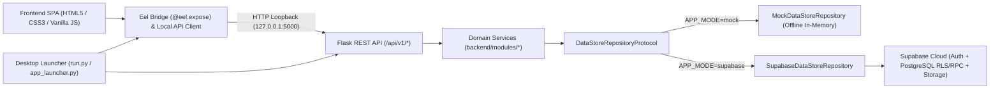

# Turnamen.in: Esports Tournament Management System

**Turnamen.in** adalah aplikasi desktop berbasis **Python Eel + Flask REST API + Supabase PostgreSQL** untuk Windows 10/11 yang membantu penyelenggara, panitia, kapten tim, pemain, dan penonton mengelola serta mengikuti turnamen e-sport secara terpusat.

---

## 1. Project Overview

**Turnamen.in** dirancang untuk menggantikan pengelolaan turnamen e-sport yang sebelumnya tersebar di spreadsheet, formulir manual, dan grup chat dengan satu dashboard desktop *Futuristic Arena* yang terstruktur dan diaudit berbasis peran.

**Masalah yang Diselesaikan:**
- Mencegah manipulasi skor atau perubahan status turnamen tidak sah melalui otorisasi RBAC 5 role di backend serta PostgreSQL Row Level Security (RLS).
- Menyederhanakan proses pendaftaran tim, verifikasi pembayaran, penyusunan bracket **Single Elimination**, penanganan *bye*, hingga kalkulasi klasemen otomatis.
- Menyediakan katalog lintas game (*game-agnostic*) dengan dukungan poster SVG bawaan dan unggahan *custom game artwork* oleh Super Admin.

**Target Pengguna:**
1. **Super Admin:** Pengelola sistem, katalog game, *artwork* poster game, serta penetapan peran pengguna.
2. **Tournament Organizer:** Pembuat dan pengelola siklus hidup turnamen beserta penugasan panitia (*committee*).
3. **Committee (Panitia):** Verifikator registrasi/pembayaran dan pencatat hasil pertandingan pada turnamen yang ditugaskan.
4. **Team Captain:** Pembuat dan pengelola tim, anggota tim, pendaftaran turnamen, serta unggah bukti pembayaran.
5. **Player:** Pemain terdaftar yang memantau jadwal pertandingan, detail tim, pengumuman, bracket, dan hasil turnamen.

---

## 2. Main Features

Seluruh fitur berikut telah diimplementasikan pada backend (`/api/v1`), desktop launcher/Eel bridge, serta frontend SPA (`desktop/web/`):

- **Dashboard Berbasis Role:**
  - *Competitive Experience* untuk `player` dan `team_captain` (tampilan penemuan turnamen berbentuk kartu pada `.discovery-grid`, info tim, jadwal pertandingan aktif, dan pengumuman).
  - *Management Experience* untuk `super_admin`, `organizer`, dan `committee` (ringkasan metrik operasional, katalog tabel padat aksi, kontrol penugasan panitia, dan aksi berbasis izin).
- **Manajemen Turnamen:** Pembuatan, pembaruan, pembatalan, dan penghapusan turnamen; filter berdasarkan status (`draft`, `open_registration`, `registration_closed`, `ongoing`, `completed`, `cancelled`) dan game; serta transisi status turnamen tervalidasi.
- **Manajemen Tim & Peserta:** Pembuatan tim oleh `team_captain` (atau `super_admin`), pengelolaan daftar anggota (`team_members`), pendaftaran tim ke turnamen secara atomik, verifikasi registrasi & status pembayaran (`approve` / `reject` / `paid`).
- **Manajemen Pertandingan & Bracket Single Elimination:** Generator bracket otomatis (mendukung jumlah tim non-pangkat-2 melalui mekanisme *bye*), validasi skor sesuai aturan *Best-of* (`Bo1`, `Bo3`, `Bo5`, `Bo7`), perpindahan pemenang ke ronde berikutnya secara atomik, *idempotency ledger* (`match_submission_requests`), serta dukungan *force override* khusus otorisasi sah.
- **Pengelolaan Game & Custom Artwork:** Manajemen katalog game (`super_admin`), aset fallback SVG lokal (`mobile-legends.svg`, `valorant.svg`, `ea-sports-fc.svg`, `default-arena.svg`), dan unggah *custom poster artwork* PNG/JPEG/WebP (maksimal `5 MB`, dimensi `320x180` sampai `4096x4096`) ke bucket Supabase Storage `game-artwork` (atau endpoint aset lokal pada mode mock).
- **Announcements:** Publikasi pengumuman turnamen berprioritas (`normal`, `important`, `urgent`) oleh pengelola turnamen yang berwenang, serta proyeksi non-PII untuk tampilan publik turnamen non-draft.
- **Reports & Standings:** Ringkasan statistik turnamen, rekap pertandingan selesai/terjadwal, status tim peserta, dan papan klasemen (*standings*) hasil turnamen.
- **Authentication & Authorization:** Autentikasi Supabase Auth (email + password, pemulihan kata sandi, dan isolasi token JWT per request pada `APP_MODE=supabase`) serta simulasi akun mock (`X-Mock-User-Id` / `X-Mock-Role`) yang hanya aktif pada `APP_MODE=mock`.
- **Dukungan Desktop & UX:** Progressive *skeleton loading* pada panel asinkron, tombol refresh manual tanpa polling agresif, pemutus thread *gevent* terintegrasi di `desktop/bridge/eel_bridge.py`, dan pengecekan kesehatan non-interaktif (`run.py --check`).

---

## 3. User Roles

Implementasi hak akses mengacu langsung pada matriks `PERMISSION_MATRIX` dan `is_tournament_manager` di [`backend/modules/auth/permissions.py`](backend/modules/auth/permissions.py) serta [`docs/contracts/role-permissions.md`](docs/contracts/role-permissions.md):

| Role | Deskripsi & Cakupan Izin Aktual | Batasan Akses Penting |
| :--- | :--- | :--- |
| `super_admin` | Akses penuh lintas seluruh aksi di `PERMISSION_MATRIX`: kelola game & artwork (`game:manage`), tetapkan role pengguna (`user:assign_role`), kelola semua turnamen, tim, registrasi, bracket, hasil pertandingan, dan pengumuman. | Akun `super_admin` hanya untuk administrasi sistem yang sah; dilarang membagikan kredensialnya secara bebas atau menyertakan `service_role` key pada klien desktop. |
| `organizer` | Membuat, mengubah, dan menghapus turnamen (`tournament:create/update/delete`), menugaskan committee pada turnamen miliknya, memverifikasi registrasi (`registration:verify`), menyusun bracket (`bracket:generate`), mencatat hasil pertandingan (`match:submit_result`), dan membuat pengumuman (`announcement:create`). | Pada operasi edit/hapus turnamen, verifikasi registrasi, bracket, skor, dan pengumuman, hanya berlaku untuk **turnamen yang dimilikinya** (`organizer_id == user.id`). Tidak dapat mengelola katalog game atau mengubah role user. |
| `committee` | Memverifikasi registrasi (`registration:verify`), menyusun bracket (`bracket:generate`), mencatat skor pertandingan (`match:submit_result`), membuat pengumuman (`announcement:create`), dan memperbarui profil sendiri (`profile:update_own`). | Tidak dapat membuat/menghapus turnamen atau tim. Operasi operasional hanya diizinkan pada turnamen tempat ia **ditugaskan** melalui `tournament_staff` (`is_tournament_manager`). |
| `team_captain` | Membuat & memperbarui tim (`team:create/update`), menambah anggota tim (`team:add_member`), mendaftarkan tim ke turnamen (`registration:create`), dan memperbarui profil sendiri (`profile:update_own`). | Hanya boleh mengelola **tim yang dipimpinnya** (`captain_id == user.id`) serta melihat detail pembayaran/registrasi tim tersebut. |
| `player` | Membaca turnamen, bracket, pengumuman non-draft, laporan publik, serta memperbarui profil sendiri (`profile:update_own`). | Tidak memiliki izin mutasi turnamen, tim, registrasi, verifikasi, bracket, maupun pengumuman. |

---

## 4. Technology Stack

Seluruh paket Python terpin secara eksplisit di [`requirements.txt`](requirements.txt):

| Lapisan | Teknologi & Versi Terverifikasi | Peran dalam Sistem |
| :--- | :--- | :--- |
| **Runtime & Bahasa** | Python `3.10` sampai `3.12` (terverifikasi `3.12.10` 64-bit) | Bahasa utama backend, repository, desktop launcher, dan test suite |
| **Desktop Wrapper** | **Eel `0.18.2`** (`bottle==0.12.25`, `bottle-websocket==0.2.9`, `gevent==24.2.1`, `gevent-websocket==0.10.1`) | Menyajikan jendela desktop lokal berbasis Chromium/Chrome/Edge pada `127.0.0.1:8080` |
| **Backend REST API** | **Flask `3.0.3`**, `Werkzeug==3.0.4`, `requests==2.32.3` | Server API lokal `/api/v1` pada `127.0.0.1:5000` dengan validasi request & format JSON terstandar |
| **Frontend UI** | HTML5, CSS3 (*Futuristic Arena Dark Theme*), Vanilla JavaScript (ES6+) | Single-Page Application di `desktop/web/` tanpa framework eksternal berat |
| **Database & Cloud** | **Supabase (`supabase==2.34.1`)**, **PostgreSQL** (`14` tabel publik, `7` file migrasi SQL, `1` bucket Storage `game-artwork`) | Autentikasi, otorisasi RLS/RPC, persistensi relasional, dan penyimpanan *custom game artwork* |
| **Konfigurasi & Testing** | `python-dotenv==1.0.1`, `pytest==8.3.2` | Pemuatan variabel lingkungan `.env` dan eksekusi unit serta integration test |

> **Catatan Pemeliharaan Eel `0.18.2`:** Pustaka `Eel` sudah tidak aktif dipelihara di upstream. Proyek memin versi `Eel==0.18.2` beserta dependensinya (`gevent`, `bottle`), mengunci binding server hanya ke `127.0.0.1`, menonaktifkan proxy lingkungan pada bridge HTTP lokal, dan membatasi fungsi `@eel.expose` hanya sebagai proksi ke `/api/v1`.

---

## 5. Application Architecture

Aplikasi menerapkan pemisahan tanggung jawab berlapis agar desktop wrapper maupun mode API memakai satu sumber logika bisnis di `backend/modules/`:



- **Backend (`backend/`):** Application factory (`backend/app.py`), routes (`/api/v1/*` di `backend/api/routes/v1_routes.py`), validator schema (`backend/api/schemas/`), konfigurasi & redaksi log (`backend/core/`), serta modul domain (`auth`, `tournaments`, `teams`, `matches`, `announcements`, `reports`).
- **Desktop Launcher (`run.py`, `desktop/launcher/app_launcher.py`):** Menjalankan server Flask API lokal (dengan pemeriksaan kesiapan health) dan membuka jendela Chromium via Eel (`--api-only`, `--check`, `--mode`, `--port`).
- **Eel Bridge (`desktop/bridge/eel_bridge.py`):** Meneruskan panggilan UI secara aman ke server Flask `127.0.0.1` dengan proteksi path traversal, whitelist metode/header HTTP, per-thread `requests.Session` terisolasi dari env proxy, serta *gevent* non-blocking.
- **Frontend (`desktop/web/`):** SPA dengan `index.html`, sistem token warna gelap (`variables.css`, `layout.css`, `components.css`), modul core JS (`config.js`, `eel-bridge.js`, `api-client.js`), komponen UI (`ui-components.js`), dan renderer halaman (`app-pages.js`).
- **Repository Layer (`backend/repositories/`):** Kontrak seragam [`repository_protocol.py`](backend/repositories/interfaces/repository_protocol.py) yang diimplementasikan oleh `MockDataStoreRepository` (`APP_MODE=mock`) dan `SupabaseDataStoreRepository` (`APP_MODE=supabase`).

---

## 6. Project Structure

```text
Turnamen.in/
├── .env.example                     # Template konfigurasi environment (tanpa kredensial asli)
├── .gitignore                       # Mengabaikan .env, .venv, logs, .agent, supabase/.temp, cache
├── AGENTS.md                        # Aturan kerja AI agent, branch resmi, & kepemilikan modul
├── CONTRIBUTING.md                  # Panduan kolaborasi Git tim
├── DESIGN.md                        # Panduan desain visual Futuristic Arena UI
├── README.md                        # Dokumentasi utama proyek
├── requirements.txt                 # Dependensi Python terpin (termasuk Eel==0.18.2)
├── run.py                           # Entry point launcher (--check, --api-only, --mode, --port)
├── skills-lock.json                 # Lockfile metadata skills proyek
├── .agents/skills/                  # 18 Agent Skills proyek (11 eksternal + 7 custom Turnamen.in)
├── backend/
│   ├── app.py                       # Flask application factory & error handlers
│   ├── api/
│   │   ├── routes/v1_routes.py      # Endpoint REST API /api/v1/*
│   │   └── schemas/                 # Formatter JSON & validator request
│   ├── contracts/dtos.py            # Konstanta role, status, dan DTO kontrak bersama
│   ├── core/                        # config.py, exceptions.py, logging_config.py
│   ├── infrastructure/supabase/     # Klien Supabase & isolasi token per request
│   ├── modules/                     # Logika bisnis: auth, tournaments, teams, matches, announcements, reports
│   └── repositories/                # interfaces/, mock/, supabase/, dan factory.py
├── desktop/
│   ├── bridge/eel_bridge.py         # @eel.expose proxy tervalidasi ke localhost Flask API
│   ├── launcher/app_launcher.py     # Orkestrator startup Flask + Eel & run_smoke_check()
│   └── web/
│       ├── index.html               # App shell SPA utama
│       ├── pages/                   # Partial HTML awal per halaman (status: perlu review penggunaan)
│       └── assets/
│           ├── css/                 # variables.css, layout.css, components.css
│           ├── images/              # logo.svg dan fallback SVG poster game di images/games/
│           └── js/                  # core/, components/, pages/app-pages.js
├── docs/
│   ├── api/                         # Ringkasan endpoint REST API
│   ├── contracts/                   # Kontrak resmi: api, database, frontend, module, role-permissions
│   ├── finalization/                # Laporan readiness, audit deployment, UI smoke test, & integrasi
│   ├── guides/                      # Panduan setup pengembang Windows
│   ├── tasks/                       # Daftar tugas mandiri per anggota (5 file)
│   ├── wave4/                       # Dokumentasi validasi PG17 & auth trigger Wave 4
│   ├── GIT_WORKFLOW.md              # Prosedur resmi branch per anggota
│   ├── architecture.md
│   ├── database-schema.md           # Dokumentasi ERD 14 tabel, 7 migrasi, RLS, RPC, & Storage
│   ├── security.md
│   └── skill-sources.md
├── scripts/
│   └── verify_starter.py            # Verifikasi kelengkapan 18 skills & smoke check aplikasi
├── supabase/
│   ├── migrations/                  # 7 migrasi SQL berurutan (0001 s/d 20261126232622)
│   └── seed.sql                     # Data awal demo pengembangan
└── tests/
    ├── conftest.py                  # Fixture Flask test client & mock services
    ├── integration/                 # Pengujian endpoint API, RBAC status code, & migrasi PostgreSQL
    └── unit/                        # Pengujian unit domain, config, Eel bridge, & Wave 1-6.11
```

---

## 7. System Requirements

Berdasarkan environment yang telah diuji dan diverifikasi pada pengembangan saat ini:
- **Sistem Operasi:** **Windows 11** (terverifikasi pada `Windows-11-10.0.26300-SP0`; ditargetkan untuk keluarga Windows 10/11 64-bit; sistem operasi lain seperti Linux/macOS belum diuji).
- **Python:** Python `3.10`, `3.11`, atau `3.12` (terverifikasi berjalan penuh di **Python `3.12.10` 64-bit**).
- **Browser Desktop untuk Eel:** Google Chrome atau browser berbasis Chromium (default `EEL_BROWSER_MODE=chrome` untuk membuka jendela desktop lokal).
- **Koneksi Internet:**
  - `APP_MODE=mock`: **Tidak memerlukan koneksi internet** (berjalan 100% lokal in-memory).
  - `APP_MODE=supabase`: **Memerlukan koneksi internet** stabil ke endpoint proyek Supabase Cloud (`HTTPS`).

---

## 8. Installation

Jalankan langkah berikut di **Windows PowerShell** dari folder kerja tempat Anda ingin menyimpan proyek:

```powershell
# 1. Clone repository dan masuk ke direktori proyek
git clone https://github.com/FikriYuzaki/projek_eapp_kelompok_2_turnamen.id.git
cd projek_eapp_kelompok_2_turnamen.id

# 2. Buat dan aktifkan virtual environment Python
python -m venv .venv
.\.venv\Scripts\Activate.ps1

# 3. Perbarui pip (opsional) dan pasang seluruh dependensi terpin
pip install -r requirements.txt

# 4. Salin file contoh konfigurasi lokal
Copy-Item .env.example .env
```

---

## 9. Configuration

File konfigurasi dikelola di `backend/core/config.py` dan template [`.env.example`](.env.example). **Jangan pernah menyimpan file `.env`, password, JWT pengguna, `sb_secret_*`, atau `service_role` key ke repository Git.**

1. **Mode Aplikasi (`APP_MODE`):**
   - `APP_MODE=mock` *(default aman)*: Menggunakan `MockDataStoreRepository` di memori lokal dengan 5 akun simulasi, 3 game awal, dan tanpa koneksi ke Supabase Cloud.
   - `APP_MODE=supabase`: Menggunakan `SupabaseDataStoreRepository` dan Supabase Auth. Wajib mengisi `SUPABASE_URL` serta `SUPABASE_PUBLISHABLE_KEY` yang valid.
2. **Kredensial Supabase (Aman untuk Klien Desktop):**
   - `SUPABASE_URL=https://<project-ref>.supabase.co`
   - `SUPABASE_PUBLISHABLE_KEY=sb_publishable_...` *(prioritas utama; `SUPABASE_ANON_KEY` hanya dipertahankan sebagai fallback kompatibilitas ter-deprecate dan tidak boleh diisi nilai berbeda sekaligus)*.
   - Aplikasi akan menolak startup (`ValueError`) apabila mendeteksi `sb_secret_*` atau klaim JWT `service_role` di konfigurasi desktop.
3. **Konfigurasi Storage Bucket (`SUPABASE_STORAGE_BUCKET` vs `GAME_ARTWORK_BUCKET`):**
   - `SUPABASE_STORAGE_BUCKET=tournament-assets` pada `.env.example` bersifat **cadangan konfigurasi opsional** untuk aset turnamen umum di masa depan dan **tidak dipakai oleh alur unggah poster game**.
   - Alur manajemen *custom game artwork* (Wave 6.11) menggunakan konstanta kode [`GAME_ARTWORK_BUCKET = "game-artwork"`](backend/modules/tournaments/artwork_validator.py#L14) yang terhubung ke bucket Supabase Storage `game-artwork` dan tabel `game_artwork_overrides`.
4. **Keamanan Host & Port Lokal:**
   - `API_HOST` dan `EEL_HOST` dikunci wajib ke `127.0.0.1` (`API_PORT=5000`, `EEL_PORT=8080`, `API_PORT != EEL_PORT`).

---

## 10. Running the Application

Pastikan virtual environment `.venv` aktif (atau gunakan path `.\.venv\Scripts\python.exe`):

```powershell
# Pemeriksaan cepat non-interaktif (config, API /health, mock repository)
.\.venv\Scripts\python.exe run.py --check

# Menjalankan aplikasi desktop lengkap (Flask REST API + Jendela Desktop Python Eel) dalam Mock Mode
.\.venv\Scripts\python.exe run.py --mode mock

# Menjalankan hanya Flask REST API + Web UI di browser lokal (http://127.0.0.1:5000)
.\.venv\Scripts\python.exe run.py --api-only --mode mock

# Menjalankan aplikasi desktop dalam Supabase Mode (memerlukan .env valid untuk Supabase)
.\.venv\Scripts\python.exe run.py --mode supabase
```

**Catatan Status Operasional Supabase Mode:**
- Pada lingkungan **Supabase Cloud** saat ini, **Public Signup masih dinonaktifkan** sebagai pengamanan hingga seluruh pemeriksaan pra-rilis **P1.4** (review *Supabase Security Advisors*, aktivasi *Leaked Password Protection*, uji live akun non-admin, dan benchmark wall-clock Cloud) selesai dijalankan.

---

## 11. Testing

Suite pengujian (`tests/unit/` dan `tests/integration/`) dijalankan pada mode mock sehingga seluruh pemeriksaan terautomasi dapat diverifikasi secara offline tanpa kredensial cloud.

```powershell
# 1. Jalankan seluruh unit & integration test suite
.\.venv\Scripts\pytest.exe -q

# 2. Jalankan pemeriksaan smoke check aplikasi (konfigurasi, API health, mock repository)
.\.venv\Scripts\python.exe run.py --check

# 3. Verifikasi kelengkapan 18 Agent Skills dan smoke check starter
.\.venv\Scripts\python.exe scripts/verify_starter.py

# 4. Periksa kebersihan patch dan whitespace Git
git diff --check
```

**Hasil Verifikasi Terbaru (setelah cleanup & pembaruan dokumentasi):**
- Catatan hasil eksekusi pengujian setelah pembaruan repository terdokumentasi di laporan integrasi [`docs/finalization/`](docs/finalization/). Selalu jalankan ulang perintah `pytest -q` dan `run.py --check` setiap kali melakukan perubahan kode atau konfigurasi.

---

## 12. Security Notes

- **Autentikasi & Isolasi Token:** Pada `APP_MODE=supabase`, autentikasi dilakukan melalui Supabase Auth (`email` + `password`) dan setiap request memakai klien/JWT terisolasi per request sehingga tidak terjadi kebocoran sesi antar pengguna. Mock header (`X-Mock-User-Id`, `X-Mock-Role`) ditolak secara tegas saat `APP_MODE=supabase`.
- **Otorisasi RBAC Server-Side:** Otorisasi peran dibaca dari tabel `public.profiles` (`is_active = TRUE`), bukan dari `user_metadata` klien yang dapat diubah pengguna. Trigger `trg_prevent_profile_privilege_escalation` mencegah eskalasi role/status akun oleh pengguna non-admin.
- **Row Level Security (RLS) & Schema `private`:** Seluruh `14` tabel publik mengaktifkan RLS (`0001` sampai `20261126232622`), fungsi sensitif (`SECURITY DEFINER`) ditempatkan pada schema `private` dengan `SET search_path = ''`, `matches` menggunakan idempotency ledger atomik (`0004`), dan auto-link auth by email dinonaktifkan pada trigger `0005`.
- **Supabase Storage Policies (`game-artwork`):** Bucket `game-artwork` membatasi ukuran maksimal `5 MB`, MIME `image/jpeg`, `image/png`, `image/webp`, dan memvalidasi magic bytes binary serta dimensi di backend. Operasi tulis/baca non-publik pada `storage.objects` dibatasi untuk role `super_admin` terautentikasi melalui 4 policy pada Supabase Storage Dashboard.
- **Penanganan Kredensial & Logging:** Log runtime (`backend/core/logging_config.py`) dan output `run.py --check` menyensor nilai sensitif (`***REDACTED***`). Penggunaan `sb_secret_*` maupun `service_role` pada desktop diblokir saat validasi konfigurasi.
- **Pembatasan Akun Super Admin & Public Signup:** Gunakan akun `super_admin` hanya untuk administrasi resmi dan biarkan *Public Signup* tetap nonaktif sampai agenda P1.4 tuntas.

---

## 13. Windows Packaging

- **Status Saat Ini:** Proses **Windows ONEDIR packaging** (seperti konfigurasi PyInstaller dan distribusi executable terpaket) **belum selesai / sedang dipersiapkan** setelah tahap integrasi dan sinkronisasi repository GitHub tuntas.
- Saat ini aplikasi dijalankan langsung dari source melalui virtual environment `.venv` dan `run.py` seperti dijelaskan pada Bagian 8 dan Bagian 10.

---

## 14. Project Team

Pembagian anggota kelompok, peran, branch resmi, serta area tanggung jawab mengacu pada [`AGENTS.md`](AGENTS.md):

| Anggota | Peran | Branch Resmi | Cakupan Utama |
| :--- | :--- | :--- | :--- |
| **Ferlita** | Project Coordinator & UI/UX Designer | `feature/ferlita-ui-ux` | UI/UX desktop (`desktop/web/assets/css/`, `images/`, `js/components/`, `js/pages/`), `DESIGN.md` |
| **Fikri** | System Integration & Python Eel Developer | `feature/fikri-eel` | Launcher (`run.py`, `desktop/launcher/`), `desktop/bridge/`, `desktop/web/assets/js/core/`, `backend/core/` |
| **Habil** | Database & Authentication Developer | `feature/habil-database-auth` | Skema & migrasi `supabase/`, `backend/modules/auth/`, `backend/infrastructure/supabase/`, `backend/repositories/` |
| **Adriel** | Tournament & Match System Developer | `feature/adriel-tournament-match` | Domain `tournaments/`, `teams/`, `matches/`, serta `bracket_engine.py` & `artwork_validator.py` |
| **Anisa** | REST API, Reporting & Testing Developer | `feature/anisa-api-report` | `backend/api/`, `backend/modules/reports/`, `backend/modules/announcements/`, `tests/`, `docs/api/` |

Panduan lengkap alur kerja Git dan instruksi mandiri masing-masing anggota tersedia di [`CONTRIBUTING.md`](CONTRIBUTING.md), [`docs/GIT_WORKFLOW.md`](docs/GIT_WORKFLOW.md), dan folder [`docs/tasks/`](docs/tasks/).
