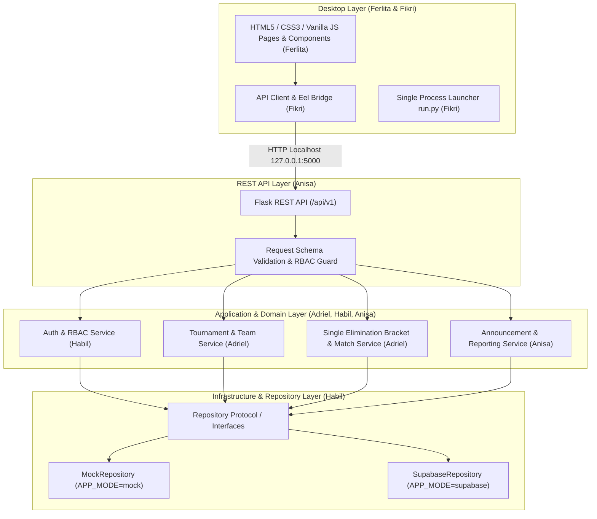

# Arsitektur Sistem — Turnamen.in

Dokumen ini menjelaskan rancangan arsitektur modular **Turnamen.in — Esports Tournament Management System** untuk Windows 10/11.

---

## 1. Gambaran Umum Arsitektur

Turnamen.in menerapkan arsitektur berlapis (*Modular Layered Architecture / Ports and Adapters*) yang proporsional untuk 5 pengembang paralel:

---

## 2. Tanggung Jawab Setiap Layer

### A. Desktop Layer (`desktop/` & `run.py`)
- Menampilkan antarmuka pengguna menggunakan HTML5, CSS3, dan Vanilla JavaScript di dalam jendela Python Eel.
- Menangani state tampilan (*Loading*, *Empty*, *Error*, *Success*) dan menampilkan indikator jelas ketika `APP_MODE=mock` aktif.
- Menjalankan Flask REST API lokal dan jendela Eel melalui satu launcher (`run.py`) dengan pengelolaan *startup* dan *graceful shutdown*.

### B. REST API Layer (`backend/app.py` & `backend/api/`)
- Menangani HTTP request dan response pada `http://127.0.0.1:5000/api/v1`.
- Memvalidasi payload request dan memeriksa autentikasi serta otorisasi role.
- Mengembalikan format JSON yang konsisten (`success`, `message`, `data` / `error`).

### C. Application Layer (`backend/modules/`)
- Menyimpan **satu-satunya implementasi business logic** (tidak ada duplikasi logika di Eel dan Flask).
- Menjalankan aturan domain: validasi kuota pendaftaran, pembuatan bracket Single Elimination (termasuk penanganan *bye*), validasi skor `best_of`, perpindahan pemenang antar-babak, dan pembuatan laporan turnamen.

### D. Infrastructure & Repository Layer (`backend/repositories/` & `backend/infrastructure/`)
- Menyediakan kontrak `RepositoryProtocol` (`backend/repositories/interfaces/`).
- Menyediakan `MockDataStoreRepository` untuk pengembangan offline/paralel tanpa kredensial cloud.
- Menyediakan `SupabaseDataStoreRepository` dan adapter Supabase untuk mode produksi/online (`APP_MODE=supabase`).

---

## 3. Keputusan Arsitektur Penting

1. **Mengapa Python Eel Dipin & Dibatasi ke Localhost?**
   Python Eel adalah platform desktop yang dipilih proyek, namun repository upstream-nya sudah tidak aktif dipelihara. Untuk memitigasi risiko keamanan dan kompatibilitas, versi dependency dipin secara ketat di `requirements.txt`, server diikat hanya ke `127.0.0.1`, dan fungsi `@eel.expose` dibatasi seminimal mungkin.
2. **Mengapa Contract-First & Mock Mode sebagai Default?**
   Dengan `APP_MODE=mock` sebagai default, kelima anggota kelompok dapat mengembangkan UI, algoritma bracket, dan endpoint REST API secara bersamaan di laptop masing-masing tanpa terhambat oleh konfigurasi jaringan atau kredensial Supabase.
3. **Mengapa Tidak Menggunakan ORM Berat seperti SQLAlchemy?**
   Turnamen.in menggunakan Supabase Python SDK dan skema PostgreSQL terkelola untuk mode cloud, serta repository berbasis memori/dict untuk mode mock. Menambahkan SQLAlchemy akan menciptakan duplikasi lapisan pemetaan yang tidak diperlukan.
