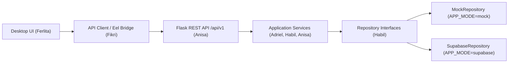

# Kontrak Modul & Service (Module & Repository Contract) — Turnamen.in

Dokumen ini mendefinisikan batas antarmuka (*Ports and Adapters*) antara lapisan **REST API** (Anisa), **Application Services** (Adriel, Habil, Anisa), dan **Repositories** (Habil).

---

## 1. Prinsip Arsitektur

- **Satu Sumber Business Logic:** Seluruh validasi domain (kuota tim, aturan skor `best_of`, algoritma Single Elimination, pemeriksaan role) berada di dalam `backend/modules/<module>/service.py`.
- **Pertukaran Repository Tanpa Mengubah Service:** Service hanya bergantung pada interface repository (`backend/repositories/interfaces/`). Pemilihan `MockRepository` atau `SupabaseRepository` dilakukan oleh factory `backend/repositories/factory.py` berdasarkan `APP_MODE`.

---

## 2. Kontrak Interface Repository (`backend/repositories/interfaces/`)

Setiap implementasi repository (`MockDataStoreRepository` maupun `SupabaseDataStoreRepository`) wajib menyediakan method berikut dengan tipe nilai kembalian `dict` atau `list[dict]` yang seragam:

### A. Profile & Auth Repository
- `list_profiles() -> list[dict]`
- `get_profile_by_id(profile_id: str) -> dict | None`
- `get_profile_by_email(email: str) -> dict | None`
- `create_profile(data: dict) -> dict`
- `update_profile(profile_id: str, data: dict) -> dict | None`

### B. Game Repository
- `list_games() -> list[dict]`
- `get_game_by_id(game_id: str) -> dict | None`

### C. Tournament Repository
- `list_tournaments(status: str | None = None, game_id: str | None = None) -> list[dict]`
- `get_tournament_by_id(tournament_id: str) -> dict | None`
- `create_tournament(data: dict) -> dict`
- `update_tournament(tournament_id: str, data: dict) -> dict | None`
- `delete_tournament(tournament_id: str) -> bool`
- `is_staff_assigned(tournament_id: str, user_id: str) -> bool`

### D. Team & Member Repository
- `list_teams(game_id: str | None = None) -> list[dict]`
- `get_team_by_id(team_id: str) -> dict | None`
- `create_team(data: dict) -> dict`
- `update_team(team_id: str, data: dict) -> dict | None`
- `list_team_members(team_id: str) -> list[dict]`
- `add_team_member(team_id: str, data: dict) -> dict`

### E. Registration Repository
- `list_registrations_by_tournament(tournament_id: str) -> list[dict]`
- `get_registration_by_id(registration_id: str) -> dict | None`
- `create_registration(data: dict) -> dict`
- `update_registration_status(registration_id: str, status: str, verified_by: str, notes: str = "") -> dict | None`

### F. Match & Bracket Repository
- `list_matches_by_tournament(tournament_id: str) -> list[dict]`
- `get_match_by_id(match_id: str) -> dict | None`
- `replace_tournament_matches(tournament_id: str, matches: list[dict]) -> list[dict]`
- `update_match(match_id: str, data: dict) -> dict | None`
- `record_match_result(data: dict) -> dict`

### G. Announcement & Activity Log Repository
- `list_announcements_by_tournament(tournament_id: str) -> list[dict]`
- `create_announcement(data: dict) -> dict`
- `log_activity(actor_id: str | None, tournament_id: str | None, entity_type: str, entity_id: str | None, action: str, details: dict) -> dict`
- `list_activity_logs(tournament_id: str | None = None) -> list[dict]`
