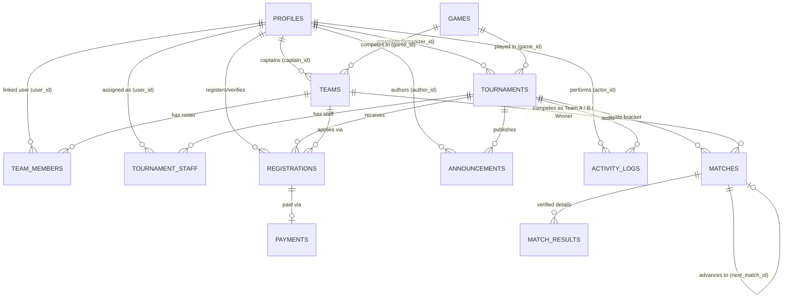

# Dokumentasi Skema Database PostgreSQL: Turnamen.in

Dokumen ini menjelaskan rancangan **Entity-Relationship Diagram (ERD)**, relasi, kardinalitas, constraint, index, dan aturan integritas untuk 12 tabel utama Turnamen.in. File migrasi SQL fisik tersedia di [`supabase/migrations/0001_initial_schema.sql`](../supabase/migrations/0001_initial_schema.sql) dan data demo tersedia di [`supabase/seed.sql`](../supabase/seed.sql).

---

## 1. Entity-Relationship Diagram (ERD)

---

## 2. Rincian 12 Tabel, Constraint, dan Aturan Delete/Update

### 1. `profiles`
- **Primary Key:** `id UUID DEFAULT gen_random_uuid()`
- **Unique Constraints:** `auth_user_id`, `email`, `username`
- **Check Constraints:** `role IN ('super_admin', 'organizer', 'committee', 'team_captain', 'player')`
- **Indexes:** `idx_profiles_role`, `idx_profiles_email`

### 2. `games`
- **Primary Key:** `id UUID DEFAULT gen_random_uuid()`
- **Unique Constraints:** `slug`
- **Check Constraints:** `team_size BETWEEN 1 AND 20`, `max_substitutes BETWEEN 0 AND 10`, `default_best_of IN (1, 3, 5, 7)`
- **Indexes:** `idx_games_slug`

### 3. `tournaments`
- **Primary Key:** `id UUID DEFAULT gen_random_uuid()`
- **Foreign Keys:**
  - `game_id` → `games(id)` (`ON DELETE RESTRICT ON UPDATE CASCADE`)
  - `organizer_id` → `profiles(id)` (`ON DELETE RESTRICT ON UPDATE CASCADE`)
- **Unique Constraints:** `slug`
- **Check Constraints:**
  - `format IN ('single_elimination')`
  - `status IN ('draft', 'open_registration', 'registration_closed', 'ongoing', 'completed', 'cancelled')`
  - `max_teams BETWEEN 2 AND 128`, `best_of IN (1, 3, 5, 7)`, `registration_fee >= 0`, `prize_pool >= 0`
  - `chk_tournament_dates`: `end_date IS NULL OR end_date >= start_date`
- **Indexes:** `idx_tournaments_game_id`, `idx_tournaments_organizer_id`, `idx_tournaments_status`, `idx_tournaments_start_date`

### 4. `teams`
- **Primary Key:** `id UUID DEFAULT gen_random_uuid()`
- **Foreign Keys:**
  - `game_id` → `games(id)` (`ON DELETE RESTRICT ON UPDATE CASCADE`)
  - `captain_id` → `profiles(id)` (`ON DELETE RESTRICT ON UPDATE CASCADE`)
- **Unique Constraints:** `name`, `tag`
- **Indexes:** `idx_teams_game_id`, `idx_teams_captain_id`

### 5. `team_members`
- **Primary Key:** `id UUID DEFAULT gen_random_uuid()`
- **Foreign Keys:**
  - `team_id` → `teams(id)` (`ON DELETE CASCADE ON UPDATE CASCADE`)
  - `user_id` → `profiles(id)` (`ON DELETE SET NULL ON UPDATE CASCADE`)
- **Unique Constraints:** `uq_team_member_ingame (team_id, ingame_id)`
- **Check Constraints:** `member_role IN ('captain', 'starter', 'substitute', 'coach')`
- **Indexes:** `idx_team_members_team_id`, `idx_team_members_user_id`

### 6. `tournament_staff`
- **Primary Key:** `id UUID DEFAULT gen_random_uuid()`
- **Foreign Keys:**
  - `tournament_id` → `tournaments(id)` (`ON DELETE CASCADE ON UPDATE CASCADE`)
  - `user_id` → `profiles(id)` (`ON DELETE CASCADE ON UPDATE CASCADE`)
- **Unique Constraints:** `uq_tournament_staff_assignment (tournament_id, user_id)`
- **Check Constraints:** `staff_role IN ('head_committee', 'referee', 'verifier', 'announcer')`

### 7. `registrations`
- **Primary Key:** `id UUID DEFAULT gen_random_uuid()`
- **Foreign Keys:**
  - `tournament_id` → `tournaments(id)` (`ON DELETE CASCADE ON UPDATE CASCADE`)
  - `team_id` → `teams(id)` (`ON DELETE RESTRICT ON UPDATE CASCADE`)
  - `registered_by` → `profiles(id)` (`ON DELETE RESTRICT ON UPDATE CASCADE`)
  - `verified_by` → `profiles(id)` (`ON DELETE SET NULL ON UPDATE CASCADE`)
- **Unique Constraints:** `uq_tournament_team_registration (tournament_id, team_id)`, `uq_tournament_seed (tournament_id, seed_number)`
- **Check Constraints:** `status IN ('pending', 'approved', 'rejected', 'withdrawn')`

### 8. `matches`
- **Primary Key:** `id UUID DEFAULT gen_random_uuid()`
- **Foreign Keys:**
  - `tournament_id` → `tournaments(id)` (`ON DELETE CASCADE ON UPDATE CASCADE`)
  - `team_a_id`, `team_b_id`, `winner_team_id` → `teams(id)` (`ON DELETE SET NULL ON UPDATE CASCADE`)
  - `next_match_id` → `matches(id)` (`ON DELETE SET NULL ON UPDATE CASCADE`)
- **Unique Constraints:** `uq_tournament_round_match (tournament_id, round_number, match_number)`
- **Check Constraints:**
  - `status IN ('scheduled', 'ongoing', 'completed', 'bye', 'disputed')`
  - `next_slot IS NULL OR next_slot IN ('A', 'B')`
  - `chk_different_teams`: `team_a_id <> team_b_id`
  - `chk_winner_valid`: `winner_team_id IS NULL OR winner_team_id = team_a_id OR winner_team_id = team_b_id`

### 9. `match_results`
- **Primary Key:** `id UUID DEFAULT gen_random_uuid()`
- **Foreign Keys:**
  - `match_id` → `matches(id)` (`ON DELETE CASCADE ON UPDATE CASCADE`)
  - `winner_team_id` → `teams(id)` (`ON DELETE RESTRICT ON UPDATE CASCADE`)
  - `verified_by` → `profiles(id)` (`ON DELETE RESTRICT ON UPDATE CASCADE`)
- **Unique Constraints:** `uq_match_game_number (match_id, game_number)`

### 10. `payments`
- **Primary Key:** `id UUID DEFAULT gen_random_uuid()`
- **Foreign Keys:**
  - `registration_id` → `registrations(id)` (`UNIQUE`, `ON DELETE CASCADE ON UPDATE CASCADE`)
  - `submitted_by` → `profiles(id)` (`ON DELETE RESTRICT ON UPDATE CASCADE`)
  - `verified_by` → `profiles(id)` (`ON DELETE SET NULL ON UPDATE CASCADE`)
- **Check Constraints:** `status IN ('unpaid', 'pending', 'verified', 'rejected', 'refunded')`, `amount >= 0`

### 11. `announcements`
- **Primary Key:** `id UUID DEFAULT gen_random_uuid()`
- **Foreign Keys:**
  - `tournament_id` → `tournaments(id)` (`ON DELETE CASCADE ON UPDATE CASCADE`)
  - `author_id` → `profiles(id)` (`ON DELETE RESTRICT ON UPDATE CASCADE`)
- **Check Constraints:** `priority IN ('normal', 'important', 'urgent')`

### 12. `activity_logs`
- **Primary Key:** `id UUID DEFAULT gen_random_uuid()`
- **Foreign Keys:**
  - `actor_id` → `profiles(id)` (`ON DELETE SET NULL ON UPDATE CASCADE`)
  - `tournament_id` → `tournaments(id)` (`ON DELETE CASCADE ON UPDATE CASCADE`)
- **Kolom Audit:** `entity_type`, `entity_id`, `action`, `details (JSONB)`, `created_at`

---

## 3. Trigger Otomatis dan Kebijakan Row Level Security (RLS)

1. **Trigger `set_updated_at()`:**
   - Diterapkan pada `profiles`, `games`, `tournaments`, `teams`, `team_members`, `registrations`, `matches`, `payments`, dan `announcements` agar kolom `updated_at` diperbarui otomatis setiap kali terjadi operasi `UPDATE`.
2. **Aktivasi RLS Menyeluruh:**
   - Seluruh 12 tabel pada skema `public` mengaktifkan `ALTER TABLE ... ENABLE ROW LEVEL SECURITY`.
3. **Fungsi Pemeriksa Role (`public.current_user_role()`):**
   - Membaca role langsung dari `public.profiles` berdasarkan `auth.uid()` dengan `SECURITY DEFINER`, bukan dari `user_metadata` yang dapat dimanipulasi klien.
4. **Perlindungan Registrasi Mandiri:**
   - Kebijakan `Self register player or captain only` pada `public.profiles` memastikan operasi `INSERT` profil baru hanya mengizinkan `role IN ('player', 'team_captain')`.
