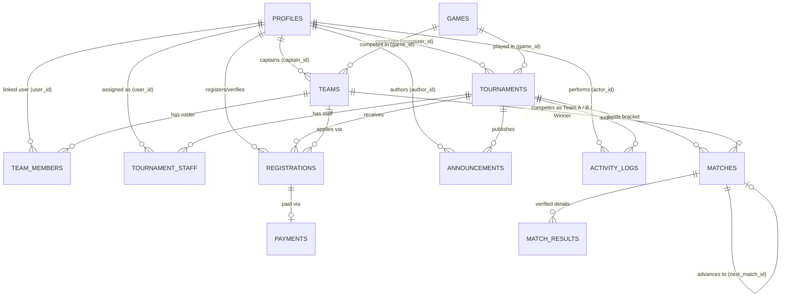

# Dokumentasi Skema Database PostgreSQL: Turnamen.in

Dokumen ini menjelaskan rancangan **Entity-Relationship Diagram (ERD)**, relasi, kardinalitas, constraint, index, dan aturan integritas untuk 12 tabel utama Turnamen.in. File migrasi SQL fisik tersedia secara berurutan di [`supabase/migrations/0001_initial_schema.sql`](../supabase/migrations/0001_initial_schema.sql) dan [`supabase/migrations/0002_security_hardening.sql`](../supabase/migrations/0002_security_hardening.sql), sedangkan data demo tersedia di [`supabase/seed.sql`](../supabase/seed.sql).

---

## 1. Entity-Relationship Diagram (ERD)

---

## 2. Rincian 12 Tabel, Constraint, dan Aturan Delete/Update

### 1. `profiles`
- **Primary Key:** `id UUID DEFAULT gen_random_uuid()`
- **Foreign Keys:** `auth_user_id` → `auth.users(id)` (`ON DELETE SET NULL`, ditambahkan secara kondisional pada `0002_security_hardening.sql`)
- **Unique Constraints:** `auth_user_id`, `email`, `username`
- **Check Constraints:** `role IN ('super_admin', 'organizer', 'committee', 'team_captain', 'player')`
- **Indexes:** `idx_profiles_role`, `idx_profiles_email`, `idx_profiles_auth_user_id`

### 2. `games`
- **Primary Key:** `id UUID DEFAULT gen_random_uuid()`
- **Unique Constraints:** `slug`
- **Check Constraints:** `team_size BETWEEN 1 AND 20`, `max_substitutes BETWEEN 0 AND 10`, `default_best_of IN (1, 3, 5, 7)`
- **Indexes:** `idx_games_slug`

### 3. `tournaments`
- **Primary Key:** `id UUID DEFAULT gen_random_uuid()`
- **Foreign Keys:**
  - `game_id` → `games(id)` (`ON DELETE RESTRICT ON UPDATE CASCADE`)
  - `organizer_id` → `profiles(id)` (`ON DELETE RESTRICT ON UPDATE CASCADE`)
- **Unique Constraints:** `slug`
- **Check Constraints:**
  - `format IN ('single_elimination')`
  - `status IN ('draft', 'open_registration', 'registration_closed', 'ongoing', 'completed', 'cancelled')`
  - `max_teams BETWEEN 2 AND 128`, `best_of IN (1, 3, 5, 7)`, `registration_fee >= 0`, `prize_pool >= 0`
  - `chk_tournament_dates`: `end_date IS NULL OR end_date >= start_date`
- **Indexes:** `idx_tournaments_game_id`, `idx_tournaments_organizer_id`, `idx_tournaments_status`, `idx_tournaments_start_date`

### 4. `teams`
- **Primary Key:** `id UUID DEFAULT gen_random_uuid()`
- **Foreign Keys:**
  - `game_id` → `games(id)` (`ON DELETE RESTRICT ON UPDATE CASCADE`)
  - `captain_id` → `profiles(id)` (`ON DELETE RESTRICT ON UPDATE CASCADE`)
- **Unique Constraints:** `name`, `tag`
- **Indexes:** `idx_teams_game_id`, `idx_teams_captain_id`

### 5. `team_members`
- **Primary Key:** `id UUID DEFAULT gen_random_uuid()`
- **Foreign Keys:**
  - `team_id` → `teams(id)` (`ON DELETE CASCADE ON UPDATE CASCADE`)
  - `user_id` → `profiles(id)` (`ON DELETE SET NULL ON UPDATE CASCADE`)
- **Unique Constraints:** `uq_team_member_ingame (team_id, ingame_id)`
- **Check Constraints:** `member_role IN ('captain', 'starter', 'substitute', 'coach')`
- **Indexes:** `idx_team_members_team_id`, `idx_team_members_user_id`

### 6. `tournament_staff`
- **Primary Key:** `id UUID DEFAULT gen_random_uuid()`
- **Foreign Keys:**
  - `tournament_id` → `tournaments(id)` (`ON DELETE CASCADE ON UPDATE CASCADE`)
  - `user_id` → `profiles(id)` (`ON DELETE CASCADE ON UPDATE CASCADE`)
- **Unique Constraints:** `uq_tournament_staff_assignment (tournament_id, user_id)`
- **Check Constraints:** `staff_role IN ('head_committee', 'referee', 'verifier', 'announcer')`

### 7. `registrations`
- **Primary Key:** `id UUID DEFAULT gen_random_uuid()`
- **Foreign Keys:**
  - `tournament_id` → `tournaments(id)` (`ON DELETE CASCADE ON UPDATE CASCADE`)
  - `team_id` → `teams(id)` (`ON DELETE RESTRICT ON UPDATE CASCADE`)
  - `registered_by` → `profiles(id)` (`ON DELETE RESTRICT ON UPDATE CASCADE`)
  - `verified_by` → `profiles(id)` (`ON DELETE SET NULL ON UPDATE CASCADE`)
- **Unique Constraints:** `uq_tournament_team_registration (tournament_id, team_id)`, `uq_tournament_seed (tournament_id, seed_number)`
- **Check Constraints:** `status IN ('pending', 'approved', 'rejected', 'withdrawn')`

### 8. `matches`
- **Primary Key:** `id UUID DEFAULT gen_random_uuid()`
- **Foreign Keys:**
  - `tournament_id` → `tournaments(id)` (`ON DELETE CASCADE ON UPDATE CASCADE`)
  - `team_a_id`, `team_b_id`, `winner_team_id` → `teams(id)` (`ON DELETE SET NULL ON UPDATE CASCADE`)
  - `next_match_id` → `matches(id)` (`ON DELETE SET NULL ON UPDATE CASCADE`)
- **Unique Constraints:** `uq_tournament_round_match (tournament_id, round_number, match_number)`
- **Check Constraints:**
  - `status IN ('scheduled', 'ongoing', 'completed', 'bye', 'disputed')`
  - `next_slot IS NULL OR next_slot IN ('A', 'B')`
  - `chk_different_teams`: `team_a_id <> team_b_id`
  - `chk_winner_valid`: `winner_team_id IS NULL OR winner_team_id = team_a_id OR winner_team_id = team_b_id`

### 9. `match_results`
- **Primary Key:** `id UUID DEFAULT gen_random_uuid()`
- **Foreign Keys:**
  - `match_id` → `matches(id)` (`ON DELETE CASCADE ON UPDATE CASCADE`)
  - `winner_team_id` → `teams(id)` (`ON DELETE RESTRICT ON UPDATE CASCADE`)
  - `verified_by` → `profiles(id)` (`ON DELETE RESTRICT ON UPDATE CASCADE`)
- **Unique Constraints:** `uq_match_game_number (match_id, game_number)`

### 10. `payments`
- **Primary Key:** `id UUID DEFAULT gen_random_uuid()`
- **Foreign Keys:**
  - `registration_id` → `registrations(id)` (`UNIQUE`, `ON DELETE CASCADE ON UPDATE CASCADE`)
  - `submitted_by` → `profiles(id)` (`ON DELETE RESTRICT ON UPDATE CASCADE`)
  - `verified_by` → `profiles(id)` (`ON DELETE SET NULL ON UPDATE CASCADE`)
- **Check Constraints:** `status IN ('unpaid', 'pending', 'verified', 'rejected', 'refunded')`, `amount >= 0`

### 11. `announcements`
- **Primary Key:** `id UUID DEFAULT gen_random_uuid()`
- **Foreign Keys:**
  - `tournament_id` → `tournaments(id)` (`ON DELETE CASCADE ON UPDATE CASCADE`)
  - `author_id` → `profiles(id)` (`ON DELETE RESTRICT ON UPDATE CASCADE`)
- **Check Constraints:** `priority IN ('normal', 'important', 'urgent')`

### 12. `activity_logs`
- **Primary Key:** `id UUID DEFAULT gen_random_uuid()`
- **Foreign Keys:**
  - `actor_id` → `profiles(id)` (`ON DELETE SET NULL ON UPDATE CASCADE`)
  - `tournament_id` → `tournaments(id)` (`ON DELETE CASCADE ON UPDATE CASCADE`)
- **Kolom Audit:** `entity_type`, `entity_id`, `action`, `details (JSONB)`, `created_at`

---

## 3. Trigger Otomatis, Fungsi SQL, dan Kebijakan Row Level Security (RLS)

1. **Trigger `set_updated_at()`:**
   - Diterapkan pada `profiles`, `games`, `tournaments`, `teams`, `team_members`, `registrations`, `matches`, `payments`, dan `announcements` agar kolom `updated_at` diperbarui otomatis setiap kali terjadi operasi `UPDATE`.
2. **Sinkronisasi Otomatis Supabase Auth (`on_auth_user_created`):**
   - Trigger `handle_new_auth_user()` pada `auth.users` menyinkronkan akun Supabase Auth baru ke `public.profiles` secara otomatis dan membatasi role registrasi mandiri hanya pada `'player'` atau `'team_captain'`.
3. **Pencegahan Eskalasi Hak Akses (`trg_prevent_profile_privilege_escalation`):**
   - Trigger `BEFORE UPDATE ON public.profiles` menolak perubahan kolom `id`, `created_at`, `role`, `is_active`, `auth_user_id`, `email`, dan `username` oleh pengguna selain `super_admin`. Kebijakan RLS `Profiles update own` tidak menggunakan subquery self-reference sehingga bebas dari *infinite recursion* (`42P17`).
4. **RPC Transaksional Bracket (`public.replace_tournament_matches`):**
   - Memvalidasi `p_tournament_id IS NOT NULL`, keberadaan turnamen, `p_matches IS NOT NULL`, `jsonb_typeof(p_matches) = 'array'`, serta struktur setiap elemen pertandingan **sebelum** menjalankan `DELETE`. Mengganti seluruh pertandingan bracket suatu turnamen secara atomik dalam satu transaksi PostgreSQL (urutan `round_number DESC, match_number ASC` agar `next_match_id` valid) menggunakan `SECURITY INVOKER` sehingga tetap tunduk pada RLS.
5. **Fungsi Pemeriksa Identitas & Kepemilikan (`0002_security_hardening.sql`):**
   - `public.current_profile_id()` dan `public.current_user_role()` membaca identitas dan role langsung dari `public.profiles` berdasarkan `(SELECT auth.uid())`, bukan dari `user_metadata`.
   - `public.is_tournament_organizer(tournament_id)`, `public.is_tournament_committee(tournament_id)`, dan `public.is_team_captain(team_id)` memverifikasi kepemilikan entitas secara ketat.
6. **Matriks RLS 12 Tabel (`ENABLE ROW LEVEL SECURITY`):**
   - `profiles`: `SELECT` dibatasi untuk pemilik profil sendiri atau staf (`super_admin`, `organizer`, `committee`); `INSERT` mandiri hanya untuk `role IN ('player', 'team_captain')`; `UPDATE` mandiri tidak dapat mengubah `role`/`email`/`is_active`; `super_admin` memiliki akses penuh.
   - `games`: `SELECT` publik untuk game aktif; operasi tulis hanya untuk `super_admin`.
   - `tournaments`: `SELECT` publik; `INSERT`/`UPDATE`/`DELETE` hanya untuk `super_admin` atau `organizer` pemilik turnamen (`organizer_id = current_profile_id()`).
   - `teams` & `team_members`: `SELECT` publik; `INSERT`/`UPDATE` tim dan kelola anggota tim hanya untuk `super_admin` atau `team_captain` pemilik tim (`captain_id = current_profile_id()`).
   - `tournament_staff`: `SELECT` hanya untuk staf terkait, `organizer` pemilik turnamen, dan `super_admin`; pengelolaan hanya untuk `organizer` pemilik turnamen dan `super_admin`.
   - `registrations`: `SELECT` publik hanya untuk `status = 'approved'`; status lainnya hanya dapat dibaca oleh kapten tim terkait, staf turnamen, dan `super_admin`; `INSERT` oleh `team_captain` pemilik tim; `UPDATE` verifikasi oleh `organizer`/assigned `committee`/`super_admin`.
   - `matches` & `match_results`: `SELECT` publik; operasi tulis hanya untuk `organizer` pemilik turnamen, `committee` yang ditugaskan pada turnamen tersebut, dan `super_admin`.
   - `payments`: Data finansial bersifat privat (`TO authenticated`); hanya dapat dibaca/diunggah oleh `team_captain` pemilik registrasi dan dibaca/diverifikasi oleh `organizer`, assigned `committee`, serta `super_admin`.
   - `announcements`: `SELECT` publik; operasi tulis hanya untuk `organizer` pemilik turnamen, assigned `committee`, dan `super_admin`.
   - `activity_logs`: Audit log bersifat *append-only* (tanpa kebijakan `UPDATE`/`DELETE`); `SELECT` hanya untuk aktor terkait, staf turnamen terkait, atau `super_admin`; `INSERT` hanya untuk pengguna terautentikasi dengan `actor_id = current_profile_id()` atau `super_admin`.

---

## 4. Cara Menjalankan Migrasi Database

Jalankan file migrasi secara berurutan pada SQL Editor Supabase atau melalui Supabase CLI:
1. `supabase/migrations/0001_initial_schema.sql` — Membuat 12 tabel, constraint, index, dan trigger dasar.
2. `supabase/migrations/0002_security_hardening.sql` — Menambahkan foreign key `auth.users`, trigger anti-privilege escalation, fungsi RPC atomik bracket, dan kebijakan RLS least-privilege.
3. `supabase/seed.sql` *(opsional untuk environment pengembangan/demo)* — Mengisi data awal 5 akun demo, 3 game, 2 turnamen, 8 tim, dan bracket contoh.
