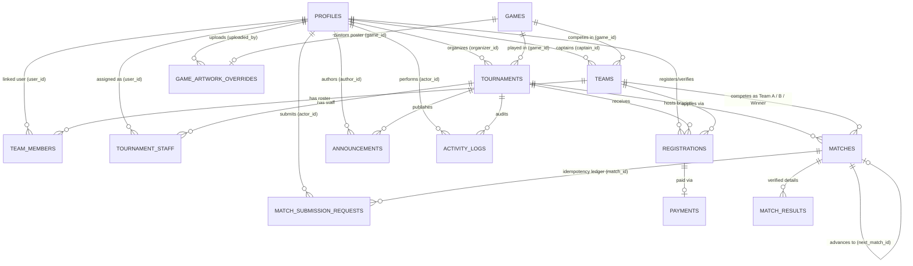

# Dokumentasi Skema Database PostgreSQL: Turnamen.in

Dokumen ini menjelaskan rancangan **Entity-Relationship Diagram (ERD)**, relasi, kardinalitas, constraint, index, fungsi RPC, dan aturan integritas untuk **14 tabel publik aktif** Turnamen.in beserta bucket Supabase Storage `game-artwork`. File migrasi SQL fisik tersedia secara berurutan di [`supabase/migrations/`](../supabase/migrations/) (`0001_initial_schema.sql` sampai `0006_wave5_functional_rpc.sql` serta `20261126232622_wave6_11_custom_game_artwork.sql`), sedangkan data demo tersedia di [`supabase/seed.sql`](../supabase/seed.sql).

---

## 1. Entity-Relationship Diagram (ERD)

---

## 2. Rincian 14 Tabel, Constraint, dan Aturan Delete/Update

### 1. `profiles`
- **Primary Key:** `id UUID DEFAULT gen_random_uuid()`
- **Foreign Keys:** `auth_user_id` -> `auth.users(id)` (`ON DELETE SET NULL`, ditambahkan secara kondisional pada `0002_security_hardening.sql`)
- **Unique Constraints / Indexes:** `auth_user_id`, `email`, `username`, serta `uq_profiles_lower_email` (`LOWER(email)`, ditambahkan pada `0005_supa001_auth_trigger_hardening.sql`)
- **Check Constraints:** `role IN ('super_admin', 'organizer', 'committee', 'team_captain', 'player')`
- **Indexes:** `idx_profiles_role`, `idx_profiles_email`, `idx_profiles_auth_user_id`, `uq_profiles_lower_email`

### 2. `games`
- **Primary Key:** `id UUID DEFAULT gen_random_uuid()`
- **Unique Constraints:** `slug`
- **Check Constraints:** `team_size BETWEEN 1 AND 20`, `max_substitutes BETWEEN 0 AND 10`, `default_best_of IN (1, 3, 5, 7)`
- **Indexes:** `idx_games_slug`

### 3. `tournaments`
- **Primary Key:** `id UUID DEFAULT gen_random_uuid()`
- **Foreign Keys:**
  - `game_id` -> `games(id)` (`ON DELETE RESTRICT ON UPDATE CASCADE`)
  - `organizer_id` -> `profiles(id)` (`ON DELETE RESTRICT ON UPDATE CASCADE`)
- **Unique Constraints:** `slug`
- **Check Constraints:**
  - `format IN ('single_elimination')`
  - `status IN ('draft', 'open_registration', 'registration_closed', 'ongoing', 'completed', 'cancelled')`
  - `max_teams BETWEEN 2 AND 128`, `best_of IN (1, 3, 5, 7)`, `registration_fee >= 0`, `prize_pool >= 0`
  - `chk_tournament_dates`: `end_date IS NULL OR end_date >= start_date`
- **Indexes:** `idx_tournaments_game_id`, `idx_tournaments_organizer_id`, `idx_tournaments_status`, `idx_tournaments_start_date`

### 4. `teams`
- **Primary Key:** `id UUID DEFAULT gen_random_uuid()`
- **Foreign Keys:**
  - `game_id` -> `games(id)` (`ON DELETE RESTRICT ON UPDATE CASCADE`)
  - `captain_id` -> `profiles(id)` (`ON DELETE RESTRICT ON UPDATE CASCADE`)
- **Unique Constraints:** `name`, `tag`
- **Indexes:** `idx_teams_game_id`, `idx_teams_captain_id`

### 5. `team_members`
- **Primary Key:** `id UUID DEFAULT gen_random_uuid()`
- **Foreign Keys:**
  - `team_id` -> `teams(id)` (`ON DELETE CASCADE ON UPDATE CASCADE`)
  - `user_id` -> `profiles(id)` (`ON DELETE SET NULL ON UPDATE CASCADE`)
- **Unique Constraints:** `uq_team_member_ingame (team_id, ingame_id)`
- **Check Constraints:** `member_role IN ('captain', 'starter', 'substitute', 'coach')`
- **Indexes:** `idx_team_members_team_id`, `idx_team_members_user_id`

### 6. `tournament_staff`
- **Primary Key:** `id UUID DEFAULT gen_random_uuid()`
- **Foreign Keys:**
  - `tournament_id` -> `tournaments(id)` (`ON DELETE CASCADE ON UPDATE CASCADE`)
  - `user_id` -> `profiles(id)` (`ON DELETE CASCADE ON UPDATE CASCADE`)
- **Unique Constraints:** `uq_tournament_staff_assignment (tournament_id, user_id)`
- **Check Constraints:** `staff_role IN ('head_committee', 'referee', 'verifier', 'announcer')`

### 7. `registrations`
- **Primary Key:** `id UUID DEFAULT gen_random_uuid()`
- **Foreign Keys:**
  - `tournament_id` -> `tournaments(id)` (`ON DELETE CASCADE ON UPDATE CASCADE`)
  - `team_id` -> `teams(id)` (`ON DELETE RESTRICT ON UPDATE CASCADE`)
  - `registered_by` -> `profiles(id)` (`ON DELETE RESTRICT ON UPDATE CASCADE`)
  - `verified_by` -> `profiles(id)` (`ON DELETE SET NULL ON UPDATE CASCADE`)
- **Unique Constraints:** `uq_tournament_team_registration (tournament_id, team_id)`, `uq_tournament_seed (tournament_id, seed_number)`
- **Check Constraints:** `status IN ('pending', 'approved', 'rejected', 'withdrawn')`

### 8. `matches`
- **Primary Key:** `id UUID DEFAULT gen_random_uuid()`
- **Foreign Keys:**
  - `tournament_id` -> `tournaments(id)` (`ON DELETE CASCADE ON UPDATE CASCADE`)
  - `team_a_id`, `team_b_id`, `winner_team_id` -> `teams(id)` (`ON DELETE SET NULL ON UPDATE CASCADE`)
  - `next_match_id` -> `matches(id)` (`ON DELETE SET NULL ON UPDATE CASCADE`)
- **Unique Constraints:** `uq_tournament_round_match (tournament_id, round_number, match_number)`
- **Check Constraints:**
  - `status IN ('scheduled', 'ongoing', 'completed', 'bye', 'disputed')`
  - `next_slot IS NULL OR next_slot IN ('A', 'B')`
  - `chk_different_teams`: `team_a_id <> team_b_id`
  - `chk_winner_valid`: `winner_team_id IS NULL OR winner_team_id = team_a_id OR winner_team_id = team_b_id`

### 9. `match_results`
- **Primary Key:** `id UUID DEFAULT gen_random_uuid()`
- **Foreign Keys:**
  - `match_id` -> `matches(id)` (`ON DELETE CASCADE ON UPDATE CASCADE`)
  - `winner_team_id` -> `teams(id)` (`ON DELETE RESTRICT ON UPDATE CASCADE`)
  - `verified_by` -> `profiles(id)` (`ON DELETE RESTRICT ON UPDATE CASCADE`)
- **Unique Constraints:** `uq_match_game_number (match_id, game_number)`

### 10. `payments`
- **Primary Key:** `id UUID DEFAULT gen_random_uuid()`
- **Foreign Keys:**
  - `registration_id` -> `registrations(id)` (`UNIQUE`, `ON DELETE CASCADE ON UPDATE CASCADE`)
  - `submitted_by` -> `profiles(id)` (`ON DELETE RESTRICT ON UPDATE CASCADE`)
  - `verified_by` -> `profiles(id)` (`ON DELETE SET NULL ON UPDATE CASCADE`)
- **Check Constraints:** `status IN ('unpaid', 'pending', 'verified', 'rejected', 'refunded')`, `amount >= 0`

### 11. `announcements`
- **Primary Key:** `id UUID DEFAULT gen_random_uuid()`
- **Foreign Keys:**
  - `tournament_id` -> `tournaments(id)` (`ON DELETE CASCADE ON UPDATE CASCADE`)
  - `author_id` -> `profiles(id)` (`ON DELETE RESTRICT ON UPDATE CASCADE`)
- **Check Constraints:** `priority IN ('normal', 'important', 'urgent')`

### 12. `activity_logs`
- **Primary Key:** `id UUID DEFAULT gen_random_uuid()`
- **Foreign Keys:**
  - `actor_id` -> `profiles(id)` (`ON DELETE SET NULL ON UPDATE CASCADE`)
  - `tournament_id` -> `tournaments(id)` (`ON DELETE CASCADE ON UPDATE CASCADE`)
- **Kolom Audit:** `entity_type`, `entity_id`, `action`, `details (JSONB)`, `created_at`

### 13. `match_submission_requests` *(Migrasi `0004`)*
- **Primary Key:** `id UUID DEFAULT gen_random_uuid()`
- **Foreign Keys:**
  - `match_id` -> `matches(id)` (`ON DELETE CASCADE ON UPDATE CASCADE`)
  - `actor_id` -> `profiles(id)` (`ON DELETE RESTRICT ON UPDATE CASCADE`)
- **Kolom Idempotency:** `idempotency_key VARCHAR(128) NOT NULL`, `request_hash VARCHAR(64) NOT NULL`, `response_payload JSONB NOT NULL`, `created_at TIMESTAMPTZ NOT NULL DEFAULT NOW()`
- **Unique Constraints:** `uq_match_submission_idempotency (match_id, actor_id, idempotency_key)`
- **Indexes:** `idx_match_submission_requests_match_id`

### 14. `game_artwork_overrides` *(Migrasi `20261126232622`, Wave 6.11)*
- **Primary Key:** `id UUID DEFAULT gen_random_uuid()`
- **Foreign Keys:**
  - `game_id` -> `games(id)` (`UNIQUE`, `ON DELETE CASCADE ON UPDATE CASCADE`)
  - `uploaded_by` -> `profiles(id)` (`ON DELETE SET NULL ON UPDATE CASCADE`)
- **Kolom Metadata Poster:** `storage_path TEXT NOT NULL`, `mime_type VARCHAR(32) NOT NULL`, `file_size_bytes INT NOT NULL`, `width INT`, `height INT`, `created_at TIMESTAMPTZ`, `updated_at TIMESTAMPTZ`
- **Check Constraints:**
  - `storage_path`: panjang `btrim` `10..300`, tidak diawali `/`, tidak mengandung `..` maupun `://`, serta cocok dengan regex `^[a-z0-9-]+/[0-9a-f]{8}-[0-9a-f]{4}-[0-9a-f]{4}-[0-9a-f]{4}-[0-9a-f]{12}\.(jpe?g|png|webp)$`.
  - `mime_type IN ('image/jpeg', 'image/png', 'image/webp')`
  - `file_size_bytes > 0 AND file_size_bytes <= 5242880`
  - `width IS NULL OR (width >= 320 AND width <= 4096)` dan `height IS NULL OR (height >= 180 AND height <= 4096)`
- **Indexes:** `idx_game_artwork_overrides_uploaded_by`

---

## 3. Trigger Otomatis, Fungsi SQL/RPC, Kebijakan RLS (14 Tabel), dan Storage

1. **Trigger `set_updated_at()` (`SET search_path = ''` sejak `0005`):**
   - Diterapkan pada `profiles`, `games`, `tournaments`, `teams`, `team_members`, `registrations`, `matches`, `payments`, `announcements`, dan `game_artwork_overrides` agar kolom `updated_at` diperbarui otomatis setiap kali terjadi operasi `UPDATE`.
2. **Sinkronisasi & Hardening Supabase Auth (`on_auth_user_created` pada `0005`):**
   - Trigger `handle_new_auth_user()` (`SECURITY DEFINER`, `SET search_path = ''`) pada `auth.users` menyinkronkan akun Supabase Auth baru ke `public.profiles` dan membatasi role registrasi mandiri hanya pada `'player'` atau `'team_captain'`.
   - Menolak email duplikat (case-insensitive) dengan `SQLSTATE 23505` dan menonaktifkan *auto-link* berdasarkan email. Penautan Auth ke profil existing hanya boleh dilakukan secara eksplisit oleh `super_admin` via `private.link_profile_auth_user` / `public.link_profile_auth_user`.
3. **Pencegahan Eskalasi Hak Akses (`trg_prevent_profile_privilege_escalation`):**
   - Trigger `BEFORE UPDATE ON public.profiles` menolak perubahan kolom `id`, `created_at`, `role`, `is_active`, `auth_user_id`, `email`, dan `username` oleh pengguna selain `super_admin`. Kebijakan RLS `Profiles update own` tidak menggunakan subquery self-reference sehingga bebas dari *infinite recursion* (`42P17`).
4. **Fungsi Pemeriksa Identitas & Kepemilikan (`0002` & diperkeras `SET search_path = ''` pada `0005`):**
   - `public.current_profile_id()` dan `public.current_user_role()` membaca identitas dan role langsung dari `public.profiles` (`is_active = TRUE`) berdasarkan `(SELECT auth.uid())`, bukan dari `user_metadata`.
   - `public.is_tournament_organizer(tournament_id)`, `public.is_tournament_committee(tournament_id)`, dan `public.is_team_captain(team_id)` memverifikasi kepemilikan entitas secara ketat.
   - `public.replace_tournament_matches(p_tournament_id, p_matches)` (`SECURITY INVOKER`, `SET search_path = ''`) memvalidasi struktur bracket sebelum mengganti seluruh match secara atomik sambil tetap tunduk pada RLS.
5. **Schema `private` (`9` Fungsi `SECURITY DEFINER`, `SET search_path = ''`) & Wrapper RPC `public.*` (`0003`-`0006`):**
   - Hak akses `SCHEMA private` dicabut dari `PUBLIC` & `anon` (`GRANT USAGE TO authenticated`); seluruh wrapper `public.*` terproteksi hak `EXECUTE` per role:
     - **Migrasi `0003`:** `transition_tournament_status`, `get_public_profile_summary`, `register_team_atomic`.
     - **Migrasi `0004`:** `validate_tournament_bracket_integrity` (`private` internal) dan `submit_match_result_atomic` (atomik + idempotency ledger `match_submission_requests` + pembaruan pemenang bracket & penyelesaian turnamen).
     - **Migrasi `0005`:** `link_profile_auth_user` dan `assign_user_role` (khusus `super_admin` aktif + audit log).
     - **Migrasi `0006`:** `list_committee_candidates`, `list_tournament_staff` (`authenticated`), dan `public.list_tournament_announcements(p_tournament_id)` (`anon` & `authenticated`, proyeksi non-PII tanpa pengumuman turnamen `draft`).
6. **Matriks RLS 14 Tabel (`ENABLE ROW LEVEL SECURITY`):**
   - `profiles`: `"Profiles select own or admin"` (`SELECT` hanya pemilik profil sendiri atau `super_admin`, menggantikan policy lama sejak `0003`/`0005`); `"Profiles insert self registration"` (`role IN ('player', 'team_captain')`); `"Profiles update own"`; `"Super admin full access profiles"`.
   - `games`: `SELECT` publik untuk game aktif; operasi tulis hanya untuk `super_admin`.
   - `tournaments`: `SELECT` publik; `INSERT`/`UPDATE`/`DELETE` hanya untuk `super_admin` atau `organizer` pemilik turnamen (`organizer_id = current_profile_id()`).
   - `teams` & `team_members`: `SELECT` publik; `INSERT`/`UPDATE` tim dan kelola anggota tim hanya untuk `super_admin` atau `team_captain` pemilik tim (`captain_id = current_profile_id()`).
   - `tournament_staff`: `SELECT` hanya untuk staf terkait, `organizer` pemilik turnamen, dan `super_admin`; pengelolaan hanya untuk `organizer` pemilik turnamen dan `super_admin`.
   - `registrations`: `SELECT` publik hanya untuk `status = 'approved'`; status lainnya hanya dapat dibaca oleh kapten tim terkait, staf turnamen, dan `super_admin`; `INSERT` oleh `team_captain` pemilik tim; `UPDATE` verifikasi oleh `organizer`/assigned `committee`/`super_admin`.
   - `matches` & `match_results`: `SELECT` publik; operasi tulis hanya untuk `organizer` pemilik turnamen, `committee` yang ditugaskan pada turnamen tersebut, dan `super_admin`.
   - `payments`: Data finansial bersifat privat (`TO authenticated`); hanya dapat dibaca/diunggah oleh `team_captain` pemilik registrasi dan dibaca/diverifikasi oleh `organizer`, assigned `committee`, serta `super_admin`.
   - `announcements`: `SELECT` publik; operasi tulis hanya untuk `organizer` pemilik turnamen, assigned `committee`, dan `super_admin`.
   - `activity_logs`: Audit log bersifat *append-only* (tanpa kebijakan `UPDATE`/`DELETE`); `SELECT` hanya untuk aktor terkait, staf turnamen terkait, atau `super_admin`; `INSERT` hanya untuk pengguna terautentikasi dengan `actor_id = current_profile_id()` atau `super_admin`.
   - `match_submission_requests`: `REVOKE ALL` dari `PUBLIC` & `anon`; `REVOKE INSERT, UPDATE, DELETE` dari `authenticated`; `SELECT` terbatas `authenticated` hanya untuk `actor_id` sendiri atau `super_admin`. Penulisan dilakukan atomik di dalam RPC `private.submit_match_result_atomic`.
   - `game_artwork_overrides`: `REVOKE ALL` dari `PUBLIC`; `SELECT` untuk `anon`/`authenticated` hanya untuk game dengan `games.is_active = TRUE` atau `super_admin`; `INSERT`/`UPDATE`/`DELETE` hanya `super_admin` aktif dengan `uploaded_by = public.current_profile_id()`.
7. **Supabase Storage Bucket `game-artwork` & Split Ownership (`20261126232622`):**
   - Migrasi `20261126232622` membuat/memperbarui bucket `storage.buckets` (`id = 'game-artwork'`, `public = TRUE`, `file_size_limit = 5242880`, MIME `image/jpeg`, `image/png`, `image/webp`) sehingga aset poster publik disajikan langsung lewat `/storage/v1/object/public/game-artwork/<path>` tanpa membuka listing direktori ke `anon`.
   - Karena tabel `storage.objects` di Supabase Cloud dimiliki `supabase_storage_admin` dan role deployment `postgres` bukan anggotanya, keempat policy `storage.objects` (`SELECT`, `INSERT`, `UPDATE`, `DELETE` khusus `authenticated` dengan `bucket_id = 'game-artwork'` dan `public.current_user_role() = 'super_admin'`) dikelola melalui **Supabase Dashboard -> Storage -> Policies** (arsitektur fail-closed).

---

## 4. Urutan Migrasi Database & Catatan Operasional

Seluruh rangkaian migrasi dijalankan berurutan:
1. `supabase/migrations/0001_initial_schema.sql`: Membuat 12 tabel domain inti, constraint, index, dan trigger dasar.
2. `supabase/migrations/0002_security_hardening.sql`: Menambahkan foreign key `auth.users`, trigger anti-privilege escalation, fungsi RPC bracket, dan kebijakan RLS awal.
3. `supabase/migrations/0003_wave2_rls_compatibility.sql`: Memisahkan kebijakan profil ke `"Profiles select own or admin"` dan memindahkan RPC sensitif ke schema `private` + wrapper `public`.
4. `supabase/migrations/0004_wave2_3_atomic_match_submission.sql`: Menambahkan `match_submission_requests`, validator graf bracket rekursif, dan `submit_match_result_atomic`.
5. `supabase/migrations/0005_supa001_auth_trigger_hardening.sql`: Mengunci `search_path = ''`, menambahkan `uq_profiles_lower_email`, menonaktifkan auto-link email pada `handle_new_auth_user()`, serta menambahkan `link_profile_auth_user` dan `assign_user_role`.
6. `supabase/migrations/0006_wave5_functional_rpc.sql`: Menambahkan `list_tournament_announcements`, `list_committee_candidates`, dan `list_tournament_staff`.
7. `supabase/migrations/20261126232622_wave6_11_custom_game_artwork.sql`: Menambahkan `game_artwork_overrides` dan bucket Storage `game-artwork` (dilanjutkan pemasangan 4 policy `storage.objects` via Supabase Dashboard).
8. `supabase/seed.sql` *(opsional untuk environment demo/pengembangan)*: Mengisi 5 akun demo, 3 game resmi awal, 2 turnamen, 8 tim, dan bracket contoh.

**Persyaratan P1.4 Sebelum Rilis Publik / Pembukaan `Public Signup`:**
- Tinjau temuan **Supabase Security Advisors** (termasuk evaluasi aktivasi *Leaked Password Protection* tanpa mencabut hak `EXECUTE` `anon` pada `current_user_role()` dan `list_tournament_announcements()`).
- Jalankan uji live terkendali pada akun non-admin serta pencatatan benchmark wall-clock Cloud (`< 3 detik`) sebelum membuka kembali `Public Signup`.
